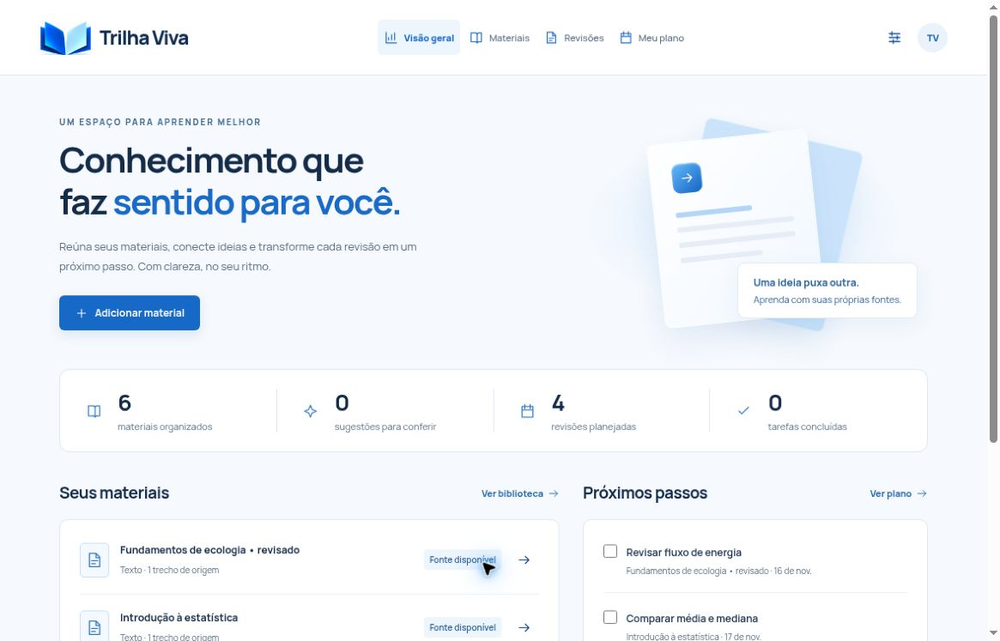
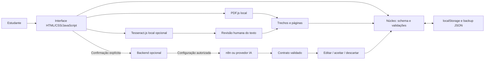
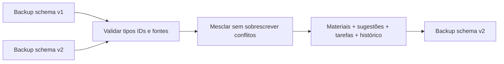

# Trilha Viva

**Do material à compreensão: estudar, conferir, revisar e avançar.**

Plataforma web de estudos que reúne materiais, organiza referências, apoia a revisão humana de conteúdo e acompanha tarefas. O projeto explora IA aplicada à aprendizagem sem confundir geração de texto com conhecimento verificado: uma resposta sugerida continua sendo uma hipótese até ser conferida na fonte.

[Repositório](https://github.com/luigiscofano/trilha-viva) · [Site no GitHub Pages](https://luigiscofano.github.io/trilha-viva/) · [Documentação](docs/README.md)

> **Estado verificado:** PRs #1–#6 integrados e frontend publicado. Materiais, OCR local, revisão, plano, histórico e backup funcionam sem cadastro. IA, importação segura de links via servidor e automações externas dependem de configuração; não estão ativadas no GitHub Pages. Contas e sincronização ainda não foram implementadas.



## Comece por aqui

- [Abrir o aplicativo](https://luigiscofano.github.io/trilha-viva/)
- [Funcionalidades e limites](#funcionalidades-e-limites-reais)
- [Identidade visual e tipografia](#direção-visual)
- [Documentação técnica e guias](docs/README.md)
- [IA e integrações: o que configurar](docs/integracoes.md)
- [Instalação, testes e uso](#instalação-e-execução)

## Objetivos acadêmicos e de produto

<details>
<summary>Expandir objetivos acadêmicos e de produto</summary>

- Transformar materiais autorizados em uma rotina de estudo organizada, sem remover o contato com a fonte original.
- Estimular recuperação ativa: formular perguntas, tentar responder e conferir explicações.
- Tornar a revisão crítica explícita: editar, aceitar ou descartar sugestões, em vez de salvar automaticamente tudo o que a IA produz.
- Explorar engenharia de software, processamento de documentos, contratos de IA, automação, acessibilidade e privacidade em um projeto verificável.
- Permitir uso local útil sem cadastro, serviço pago ou provedor de IA configurado.

Não é um tutor infalível, certificador de aprendizagem ou substituto de orientação docente. O painel acompanha atividades registradas; não mede sozinho domínio de uma disciplina.


</details>

## Funcionalidades e limites reais

<details>
<summary>Expandir funcionalidades e limites reais</summary>

| Área | Implementação no código atual |
|---|---|
| Painel e biblioteca | Materiais, progresso, tarefas e acesso às revisões |
| Materiais | Texto colado, PDF local, renomeação e exclusão com tratamento explícito de dependências |
| PDF textual | Extração local com PDF.js, trechos e páginas verificáveis; falhas e páginas vazias sinalizadas |
| PDF digitalizado | OCR local opcional com Tesseract.js, validado em navegador com PDF sintético de duas páginas; resultado editável e confirmação humana antes de salvar |
| Revisão | Tópicos, resumos e perguntas manuais ou recebidos da integração opcional; editar, aceitar, descartar e consultar fonte |
| Plano | Tarefas com datas, vínculo ao material, conclusão e reabertura |
| Calendário | Exportação manual ICS; alarme somente quando escolhido, sem envio automático |
| Histórico | Eventos duráveis no schema v2, incluídos no backup; migração de v1 sem inventar atividades passadas |
| Backup | Exportação/importação validada, união de registros e recusa de conflitos sem sobrescrita silenciosa |
| IA | Cliente, contrato e backend opcionais; nenhum provedor real foi conectado ou chamado nesta entrega |
| Links | Backend opcional restrito a `text/plain` UTF-8 em domínios autorizados, desabilitado por padrão |
| Conta e sincronização | Não ativadas; fundação SQL Supabase em preparação e não executada. Aplicativo permanece local |

Os materiais iniciais de ecologia, estatística e pensamento computacional são fictícios. As sugestões editoriais demonstrativas não são resultados de chamadas reais de IA.

### Ferramentas: uso real, não vitrine

| Ferramenta | Uso nesta implementação |
|---|---|
| JavaScript, HTML e CSS | Aplicação e interface reais, sem framework de UI |
| Node.js e `node:test` | Servidor opcional, build e testes locais |
| PDF.js | Extração real de PDFs sintéticos nos testes e fluxo local |
| Tesseract.js | Implementação de OCR local real; validado em navegador com duas páginas sintéticas, sem serviço remoto de OCR |
| Git e GitHub | Repositório público, branches, PRs e workflow de qualidade/Pages |
| n8n | Template inativo e instruções; não importado/executado em instância nesta entrega |
| Make e Zapier | Alternativas documentadas para comparar uma pequena etapa; não configurados |
| v0 e Bolt | Pontos de integração documentados; não usados para gerar esta interface |
| Cursor | Não utilizado nesta execução; instruções de desenvolvimento reproduzíveis disponíveis |


</details>

## Direção visual

<details>
<summary>Expandir direção visual</summary>

A direção azul e a logo **B · Páginas** foram aprovadas. A narrativa é de páginas que se organizam em um percurso de aprendizado: a fonte acompanha a revisão, o painel mostra o próximo passo e a ação principal recebe destaque sem disputar com o conteúdo.

Os tokens em `src/style.css` mantêm consistência:

| Papel | Cor |
|---|---|
| Ação principal | Azul `#1769C7` |
| Azul de apoio | `#104E97` |
| Texto principal | Azul profundo `#152C49` |
| Texto secundário | `#586E85` |
| Fundo | `#F6F9FD` |
| Superfície | Branco `#FFFFFF` |
| Realce leve | `#EAF3FF` |
| Divisórias | `#E0E9F3` |

Tipografia aprovada **A: Manrope nos títulos e DM Sans no corpo, controles e menus**, com fallback `system-ui`, superfícies claras, cantos moderados de 10 px e largura de conteúdo limitada. Animações são discretas e respeitam redução de movimento. A marca não reutiliza o Intuição nem a identidade de outras organizações.

As fontes variáveis reais são auto-hospedadas por meio dos pacotes Fontsource, com arquivos WOFF2 Latin/Latin Extended e licenças OFL incluídas no build. Não há solicitação ao Google Fonts. DM Sans inclui itálico real; `font-display: swap` mantém o texto legível durante o carregamento. A regra é global para todas as páginas e diálogos, sem alterar a logo aprovada. Veja [tipografia](docs/tipografia.md).


</details>

## Instalação e execução

<details>
<summary>Expandir instalação e execução</summary>

Requisitos: Node.js 22.13+ ou 24, npm e navegador moderno. Node 24 foi usado no ambiente de desenvolvimento. OCR exige Web Workers e WebAssembly; documentos grandes podem pressionar memória e bateria, especialmente no celular.

```sh
git clone https://github.com/luigiscofano/trilha-viva.git
cd trilha-viva
npm ci
npm run dev
# http://127.0.0.1:4173
```

```sh
npm test        # testes automatizados
npm run check  # verificações sintáticas configuradas
npm run build  # prepara bibliotecas locais e produz dist/
```

Em ambientes gerenciados com serviço próprio de prévia, utilize o comando de prévia da plataforma, evitando servidores concorrentes.

### Backend opcional

```sh
npm run build
npm start
# http://127.0.0.1:8787
```

Por padrão, a IA continua indisponível (`AI_PROVIDER=unconfigured`). O frontend local funciona normalmente. Para configurar posteriormente:

1. Leia [backend](docs/backend.md) e [integrações](docs/integracoes.md).
2. Copie `.env.example` para `.env` privado.
3. Escolha e autorize serviços, credenciais, retenção de dados e custos antes de habilitá-los.
4. Execute `node --env-file=.env server/study-server.mjs`.

`npm start` lê variáveis exportadas no ambiente, mas não carrega `.env` automaticamente. Nunca inclua chaves no frontend ou no repositório. **GitHub Pages não executa esse backend.** O servidor é uma base pessoal/local, não um serviço multiusuário pronto para exposição pública.


</details>

## Fluxo de uso

<details>
<summary>Expandir fluxo de uso</summary>

1. Adicione texto autorizado ou PDF em **Materiais**; confira os trechos e suas páginas.
2. Para digitalizados, escolha OCR local; revise o texto reconhecido antes de salvá-lo. OCR não é compreensão semântica e pode errar.
3. Crie tópicos, resumos e perguntas manualmente, ou use a integração de IA somente após configuração e confirmação do envio.
4. Compare as sugestões com os trechos de origem. Edite, aceite ou descarte: referência existente não comprova a resposta.
5. Organize as revisões no plano. Opcionalmente exporte ICS, com ou sem alarme escolhido por você.
6. Consulte o histórico e exporte regularmente um backup privado.

Renomear um material mantém IDs e referências. Excluir uma fonte vinculada exige compreender e confirmar a exclusão conjunta das sugestões/tarefas relacionadas; não deixa citações órfãs silenciosamente.


</details>

## Arquitetura

<details>
<summary>Expandir arquitetura</summary>





| Pasta/módulo | Responsabilidade |
|---|---|
| [`src/`](src/README.md) | Interface, núcleo, referências, PDF/OCR, IA e calendário |
| [`server/`](server/README.md) | API opcional, autenticação, limites e importação restrita |
| [`tests/`](tests/README.md) | Testes de domínio, contratos, arquivos e servidor |
| [`integrations/`](integrations/README.md) | Templates e instruções, separados de uso real |
| [`scripts/`](scripts/README.md) | Build e preparação de dependências |
| [`assets/`](assets/README.md) | Referências de marca autorizadas |
| [`docs/`](docs/README.md) | Decisões, configuração, limites e evidências |


</details>

## Dados, histórico e privacidade

<details>
<summary>Expandir dados, histórico e privacidade</summary>

Materiais, sugestões, tarefas e histórico ficam no navegador. A chave legada `trilha-viva-preview-v1` permanece para não descartar dados existentes; o conteúdo evolui para **schema 2**. Backups v1 continuam aceitos e recebem histórico vazio, sem reconstruir eventos que nunca foram registrados.

Limpar dados do navegador, usar modo privado ou trocar de aparelho pode causar perda de acesso. Não há sincronização, conta, cofre criptografado ou garantia de integridade contra alterações locais.

O backup JSON inclui textos completos. Guarde-o privadamente. A importação valida versão, tipos, IDs, relações e conflitos. Dados locais corrompidos devem ser exportados para recuperação, não sobrescritos automaticamente. Histórico registra ações, não é trilha de auditoria inviolável.

PDF e OCR são locais. Enviar um material à IA é outra etapa: título, trechos e referências selecionados passam ao backend e provedor configurado, via n8n quando habilitado. O token de operador da sessão não é a chave de API; fica na memória da aba, fora dos backups. A política do provedor/infraestrutura precisa ser revista antes de materiais privados.


</details>

## Desafios e decisões de engenharia

<details>
<summary>Expandir desafios e decisões de engenharia</summary>

- **Fonte verificável:** páginas e trechos reais em vez de citações inventadas. Validação estrutural não substitui leitura crítica.
- **PDF não é texto uniforme:** colunas, fórmulas e tabelas podem perder ordem; digitalizados precisam de OCR e conferência.
- **OCR custa recursos:** modelo e worker locais aumentam download, memória e tempo. Limites e cancelamento evitam tratar esse custo como instantâneo.
- **Evolução sem apagar progresso:** migração schema v1 → v2, importação atômica e conflitos explícitos.
- **IA opcional e protegida:** estados de indisponibilidade são funcionalidades reais; não se publica um segredo para fazer uma demo parecer integrada.
- **Links e SSRF:** a importação não é um crawler genérico; restringe destinos e tipos, não contorna login ou permissões.
- **Responsividade:** hierarquia e leitura de fontes precisam sobreviver a telas estreitas, não apenas diminuir a página desktop.


</details>

## Qualidade e validação

<details>
<summary>Expandir qualidade e validação</summary>

As suítes verificam núcleo, migração/histórico, referências, PDFs sintéticos com PDF.js real, OCR, calendário ICS, contrato/cliente de IA e servidor. Parte dos testes usa mocks controlados; eles não comprovam acesso a provedores ou serviços externos. Consulte [registro de validação](docs/validacao.md) para separar execuções anteriores da etapa atual.

Teclado, foco, rótulos, regiões de status, modais nativos e redução de movimento fazem parte da implementação. Não declaramos conformidade WCAG completa nem compatibilidade testada em todos os aparelhos. O PR #4 passou no CI com 70 testes. O OCR real foi validado no navegador com duas páginas sintéticas reconhecidas e salvas. Isso não substitui testes com documentos complexos ou aparelhos diversos; o frontend atualizado foi conferido após a implantação.


</details>

## Publicação e manutenção

<details>
<summary>Expandir publicação e manutenção</summary>

O workflow de GitHub Actions executa testes, sintaxe e build antes de publicar `dist/` no Pages. O resultado da execução/deployment é a evidência de publicação. Não deduza versão em produção apenas por este README.

PRs [#1](https://github.com/luigiscofano/trilha-viva/pull/1), [#2](https://github.com/luigiscofano/trilha-viva/pull/2), [#3](https://github.com/luigiscofano/trilha-viva/pull/3) e [#4](https://github.com/luigiscofano/trilha-viva/pull/4): integrados. Os PRs #5 e #6 integraram a documentação complementar, sua apresentação principal e a tipografia aprovada. As frentes temáticas incluem: evolução do núcleo/histórico, OCR, calendário, importação e documentação, conforme implementação e revisão reais. Não criar commits vazios ou PRs fictícios para aumentar o histórico.

`node_modules`, `vendor`, `dist`, arquivos de ambiente e logs não pertencem ao código-fonte versionado. Dependências são reconstruídas por `npm ci` e build, com respectivas licenças. Nunca publique materiais privados, backups pessoais ou capturas contendo dados reais.

Antes de exposição pública do backend: HTTPS, autenticação multiusuário, isolamento, proteção contra abuso, retenção de dados e orçamento por usuário exigem uma etapa separada. Não houve contratação ou chamada paga nesta entrega; consulte preços atuais antes de ativar serviços.

### Preparação Supabase (não ativa)

O plano de contas e sincronização está em [docs/supabase](docs/supabase/README.md), com SQL em [supabase](supabase/README.md). Nenhum projeto, login ou armazenamento remoto foi ativado. RLS e testes SQL preparados não foram executados; validação de relações/quotas e cliente ainda são bloqueadores. Não execute a migração em um projeto compartilhado ou libere multiusuário apenas por existir este código.

</details>

